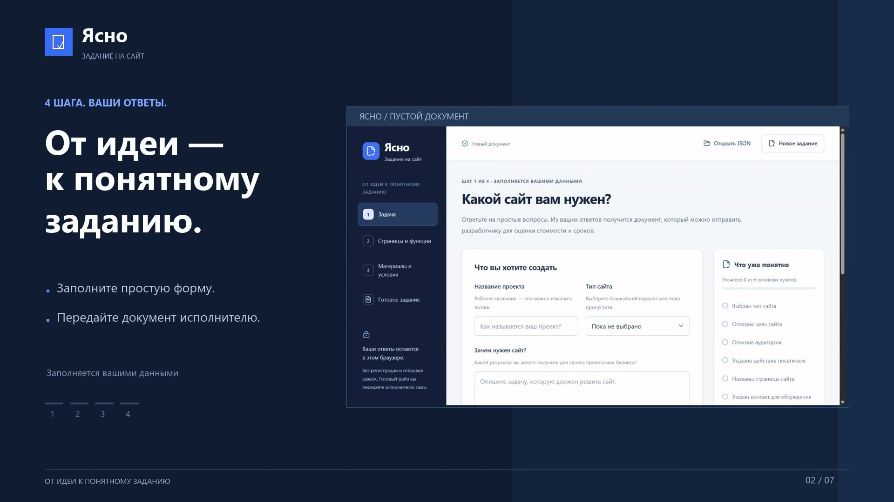
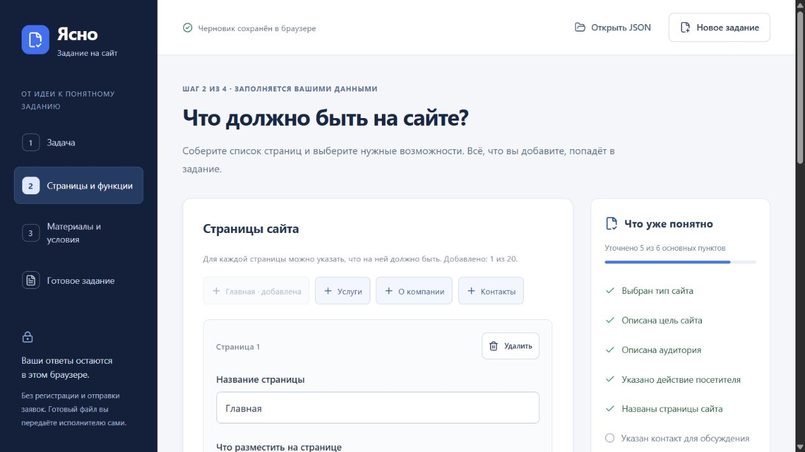
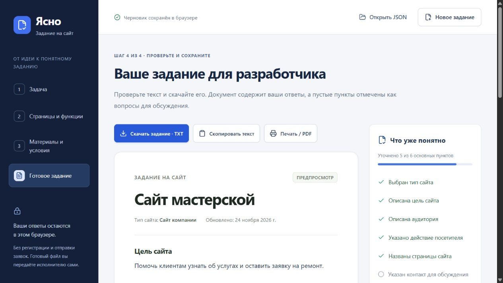

<div align="center">

# Ясно

**Превратите идею сайта в понятное задание для разработчика.**

Свои требования · Четыре шага · Готовый документ

React 19 · TypeScript · Vite · Хранение в браузере

[](https://rostislav-565.github.io/yasno/promo/)

**[Открыть приложение](https://rostislav-565.github.io/yasno/)** · **[Смотреть видео](https://rostislav-565.github.io/yasno/promo/)** · **[Исходный код](src/)**

</div>

## Для чего это нужно

Когда вы заказываете сайт, разработчику важно понять вашу задачу: кто будет пользоваться сайтом, какие страницы и функции нужны, что уже готово и какие есть ограничения. «Ясно» помогает собрать эти ответы в одном документе.

Начните с пустой формы, заполните известные детали и сохраните задание. Его можно отправить фрилансеру, студии или своей команде. Неизвестные детали останутся вопросами для обсуждения — приложение не придумает ответы вместо вас.

## Как пользоваться

| Шаг | Что вы указываете |
| --- | --- |
| **1. Задача** | Название и тип сайта, цель, аудиторию и главное действие посетителя. |
| **2. Страницы и функции** | Список страниц с описаниями и нужные возможности: форму связи, каталог, поиск, запись и другие. |
| **3. Материалы и условия** | Готовые материалы, пожелания к оформлению, ссылки, желаемую дату, свой бюджет и контакт. |
| **4. Готовое задание** | Проверяете документ, уточняете пропуски и сохраняете результат. |

Шаги можно проходить в любом порядке. Предпросмотр доступен до завершения формы, а список «Что уже понятно» помогает вернуться к неуточнённым пунктам. Заполнять все поля необязательно.

## Что можно сохранить

- **TXT** — обычный текст для отправки исполнителю.
- **Markdown** — документ с заголовками и списками.
- **JSON** — резервная копия, которую можно снова открыть в «Ясно» и продолжить редактировать.
- **Текст в буфере обмена** — для письма или сообщения.
- **Печатная версия / PDF** — через диалог печати браузера. Для PDF выберите «Сохранить как PDF», если браузер поддерживает этот вариант.

Пустой документ не экспортируется. Достаточно начать заполнять форму, чтобы сохранение стало доступно. Передачу готового файла выбранному разработчику вы выполняете самостоятельно.

## Видео

[](https://rostislav-565.github.io/yasno/promo/)

**[Смотреть со встроенным плеером](https://rostislav-565.github.io/yasno/promo/)** · [Открыть MP4](public/media/yasno-promo.mp4)

30,5 секунды · 1920×1080 · 30 кадров/с.

Сценарий демонстрации: заполнение задачи, выбор страниц и функций, проверка готового документа и сохранение результата. Любые данные, введённые специально для съёмки, служат примером: само приложение открывается с пустой формой.

## Скриншоты

Текст на кадрах введён для демонстрации. При первом запуске поля приложения пустые.

### Обзор


### Страницы и функции



### Готовое задание



### На телефоне


## Черновик и данные

Ответы автоматически сохраняются в LocalStorage текущего браузера. После повторного открытия восстанавливается последний черновик. Содержимое формы не отправляется на сервер; для работы не нужны регистрация и серверная база данных.

Черновик не синхронизируется между устройствами. Для переноса используйте JSON: сохраните копию на одном устройстве и откройте её на другом. Очистка данных сайта удаляет локальный черновик, поэтому важное задание лучше дополнительно скачать.

Импорт проверяет структуру, версию и допустимый объём данных. Повреждённый или неподходящий JSON не заменяет текущий документ. Поддерживаются файлы до 256 КБ. Перед заменой заполненного задания появляется подтверждение с возможностью сохранить текущую копию. Последнюю замену можно отменить в пределах текущего сеанса.

Если браузер запрещает LocalStorage или копирование, приложение сообщает об этом. Скачивание файлов остаётся альтернативным способом сохранить результат.

## Границы приложения

«Ясно» собирает ваши требования в документ. Оно не создаёт сайт, не подбирает исполнителя, не отправляет заявки и не рассчитывает стоимость разработки. Бюджет и дата в форме — ваши пожелания для будущего обсуждения.

В приложении нет готовых вымышленных компаний, проектов, цен или сроков. Названия страниц добавляются только после вашего нажатия. Все тексты документа основаны на введённых вами данных и списке оставшихся вопросов.

## Запуск локально

Нужны Node.js и npm. Проект проверен на Node.js 24.14 и npm 11.9; зависимости зафиксированы в `package-lock.json`.

```bash
git clone https://github.com/Rostislav-565/yasno.git
cd yasno
npm ci
npm run dev
```

Откройте [http://127.0.0.1:5187/](http://127.0.0.1:5187/). Сервер должен оставаться запущенным. Для остановки нажмите `Ctrl+C` в терминале.

В Windows после установки зависимостей можно использовать [Start-Yasno.cmd](Start-Yasno.cmd). Не открывайте `index.html` напрямую: приложение запускается через HTTP-сервер.

## Проверки и сборка

```bash
npm test
npm run lint
npm run build
```

- `npm test` — проверки модели задания, импорта JSON и текстовых экспортов.
- `npm run lint` — проверка исходников ESLint.
- `npm run build` — проверка TypeScript и production-сборка в `dist/`.

Для локального просмотра готовой сборки:

```bash
npm run preview
```

Откройте адрес, выведенный Vite в терминале. Приложение статическое: собранную папку `dist/` можно разместить на совместимом статическом хостинге.

## Исходный код

| Файл | Назначение |
| --- | --- |
| [`src/App.tsx`](src/App.tsx) | Шаги, автосохранение, импорт, подтверждения, отмена замены и экспорт. |
| [`src/components/BriefFields.tsx`](src/components/BriefFields.tsx) | Поля формы, страницы и выбор возможностей. |
| [`src/components/BriefPreview.tsx`](src/components/BriefPreview.tsx) | Предпросмотр итогового документа. |
| [`src/lib/brief.ts`](src/lib/brief.ts) | Структура задания, проверка входных данных, вопросы и форматы экспорта. |
| [`tests/brief.mjs`](tests/brief.mjs) | Проверки модели, импорта и экспорта. |
| [docs/media/](docs/media/) | Скриншоты интерфейса. |
| [public/media/](public/media/) | Промо-видео, постер и анимированное превью. |
| [public/promo/](public/promo/) | Страница видеодемонстрации для GitHub Pages. |

React 19, TypeScript со строгой проверкой типов, Vite и Lucide. Ответы обрабатываются в браузере; backend и внешние AI API не требуются.


